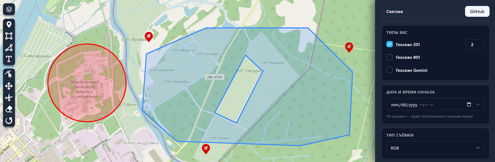

# MultiUAV Planner



Сервис планирования и распределения беспилотных авиационных работ. Рассчитывает
оптимальные полётные задания для группы БВС с учётом их характеристик,
установленных камер и ограничений воздушного пространства.

[Видео-демонстрация MultiUAV Planner](https://youtu.be/yiQ5Nb2cQxw)


## Демо

Рабочая версия доступна по адресу: **https://multiuavplanner.ru**

- Frontend: https://multiuavplanner.ru
- Swagger UI: https://multiuavplanner.ru/docs
- OpenAPI-схема: https://multiuavplanner.ru/openapi.json

## Быстрый старт

Из корня репозитория:
```bash
docker compose build
docker compose up -d
```

Сервисы:
- Frontend: http://localhost:8080
- Backend API: http://localhost:8080/docs

Остановка:
```bash
docker compose down
```

## Использование

Интерфейс разделён на вкладки «Планирование» и «Результат». После успешного
расчёта открывается результат, а карта показывает все маршруты. Основная кнопка
расчёта всегда видна, прокручивается только содержимое панели. В окнах шириной
до 1100 px настройки открываются кнопкой в правом верхнем углу карты.
Поддерживаются светлая и тёмная темы, управление вкладками с клавиатуры
и закрытие выдвижной панели и уведомлений клавишей Escape.
Подсказку на карте можно свернуть. Она отслеживает добавление и удаление зоны
съёмки и точек взлёта, включая загрузку примера и импорт запроса.

1. Откройте http://localhost:8080.
2. Нарисуйте зону съёмки и точки взлёта на карте.
3. Выберите модели БВС, количество, тип съёмки и критерий оптимизации.
4. Нажмите «Рассчитать» — результат отобразится на карте и в панели.

Можно экспортировать запрос в JSON (кнопка «Экспорт запроса») и импортировать
его обратно для повторного запуска.

После расчёта на ПК внизу карты появляется плеер миссии. Он показывает вылеты
каждого борта и события взлёта/посадки. Миссию можно проиграть со скоростью
0,5×–120×, поставить на паузу, перемотать ползунком или нажатием на строку
таймлайна. Нажатие на событие переводит плеер к его времени. Иконки БВС
двигаются по времени точек маршрута; для результатов без корректных временных
отметок используется приблизительное движение с постоянной скоростью.
Скрытие маршрута скрывает и соответствующую иконку. Сворачивание плеера
останавливает воспроизведение и убирает иконки, сохраняя текущую позицию.
При новом расчёте воспроизведение сбрасывается. На экранах шириной до 768 px
плеер скрыт.

Кнопка «Загрузить пример» находится слева над переключателем плеера миссии.
Иконки самолётов используются для моделей с положительным радиусом разворота,
квадрокоптеров — с нулевым. Название борта можно отредактировать в панели
«Маршруты»: Enter или выход из поля сохраняет название, Escape отменяет
редактирование. Названия сохраняются в этом браузере для сочетания модели и
идентификатора борта и отображаются в плеере и подсказках на карте.

## API

- Интерактивная документация (Swagger UI): http://localhost:8080/docs
- OpenAPI-схема: http://localhost:8080/openapi.json
- Описание контракта: [docs/api.md](docs/api.md)

Пример вызова:
```bash
curl -X POST http://localhost:8080/v1/plan \
  -H "Content-Type: application/json" \
  -d @request.json
```

## Ограничения воздушного пространства

Информация о запретных зонах и зонах ограничения полётов, их источниках и обработке описана в отдельном документе: [docs/zones.md](docs/zones.md).

## Разработка

| Что изменилось        | Команда                                 |
|-----------------------|-----------------------------------------|
| Python (backend/)     | docker compose restart backend          |
| C++ (cpp-module/)     | docker compose up -d --build backend    |
| Frontend (frontend/)  | docker compose up -d --build frontend   |
| Dockerfile / compose  | docker compose up -d --build            |

## Структура проекта
```
backend/      FastAPI-приложение и C++-обёртка
cpp-module/   Планировщик на C++
frontend/     React + Leaflet
docs/         Документация
```
