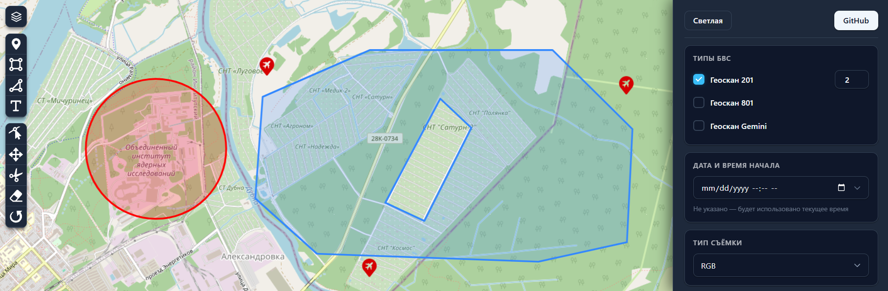

# MultiUAV Planner



Сервис планирования и распределения беспилотных авиационных работ. Рассчитывает
оптимальные полётные задания для группы БВС с учётом их характеристик,
установленных камер и ограничений воздушного пространства.

[Видео-демонстрация MultiUAV Planner](https://youtu.be/yiQ5Nb2cQxw)


## Быстрый старт

Из корня репозитория:
```bash
docker compose build
docker compose up -d
```

Сервисы:
- Frontend: http://localhost:8080
- Backend API: http://localhost:8080/docs

Остановка:
```bash
docker compose down
```


## API

- Интерактивная документация (Swagger UI): http://localhost:8080/docs
- OpenAPI-схема: http://localhost:8080/openapi.json
- Описание контракта: [docs/api.md](docs/api.md)

Пример вызова:
```bash
curl -X POST http://localhost:8080/v1/plan \
  -H "Content-Type: application/json" \
  -d @request.json
```

## Ограничения воздушного пространства

Информация о запретных зонах и зонах ограничения полётов, их источниках и обработке описана в отдельном документе: [docs/zones.md](docs/zones.md).

## Разработка

| Что изменилось        | Команда                                 |
|-----------------------|-----------------------------------------|
| Python (backend/)     | docker compose restart backend          |
| C++ (cpp-module/)     | docker compose up -d --build backend    |
| Frontend (frontend/)  | docker compose up -d --build frontend   |
| Dockerfile / compose  | docker compose up -d --build            |

## Структура проекта
```
backend/      FastAPI-приложение и C++-обёртка
cpp-module/   Планировщик на C++
frontend/     React + Leaflet
docs/         Документация
```
