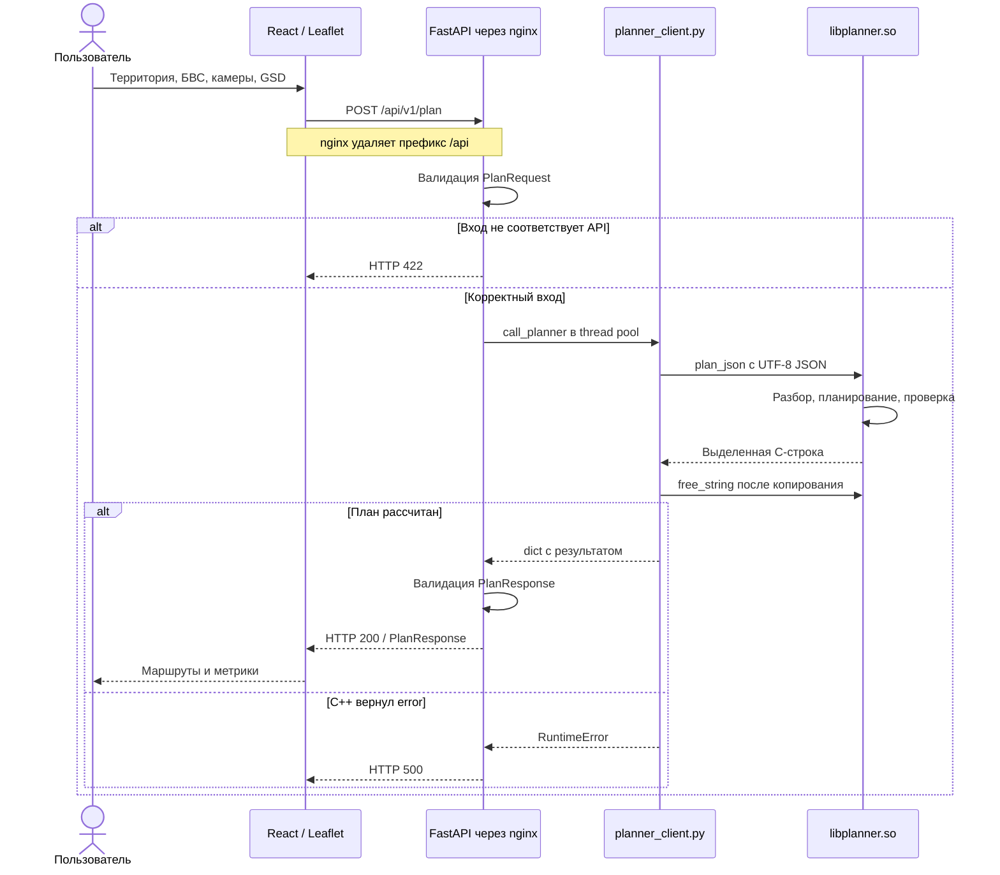
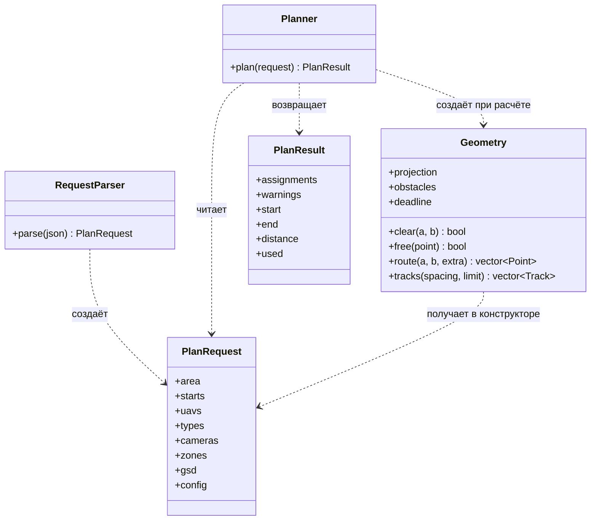

# MultiUAV Planner — краткая документация для разработчика

**Версия:** MVP от 24.09.2026, архив `cpp-module-MVP.zip` и исходный репозиторий
`MultiUAV-Planner-main(2).zip`. Документ описывает реализованный код этой поставки,
а не целевую архитектуру будущих версий. Рекомендуемое место: `cpp-module/docs/`.

## 1. Назначение и состав

Сервис строит план съёмки территории группой БВС: рабочие галсы, транзит,
вылеты и расписание. Учитываются камеры, GSD, ограничения аппаратов и запретные
зоны. Результат — маршруты с временными отметками и сводные показатели.

| Часть | Технологии и точки входа | Ответственность |
|---|---|---|
| Frontend | React, Leaflet; `frontend/src/App.jsx` | Карта, территория, площадки старта, выбор аппаратов и параметров, отображение результата |
| Подготовка запроса | `frontend/src/utils/operations.js`, `utils/plan.js` | Сбор GeoJSON, подбор камер из каталогов, HTTP-запрос, импорт/экспорт JSON |
| Веб-сервер | nginx; `frontend/nginx.conf` | Раздача UI и проксирование `/api/*` в backend |
| Backend | FastAPI, Pydantic; `backend/app/main.py`, `models.py` | Валидация API, вызов расчёта через thread pool, проверка ответа |
| Python/C++ bridge | `backend/app/planner_client.py`, ctypes | Загрузка `libplanner.so`, передача JSON, освобождение C-строки |
| Расчётное ядро | C++17; `cpp-module/Planner/` | Геометрия, маршрутизация, ограничения, вылеты и расписание |

В Docker работают два сервиса: frontend/nginx на `localhost:8080` и backend
на внутреннем порту 8000. C++ — библиотека **в процессе backend**, не отдельный
HTTP-сервис. Endpoint синхронно возвращает готовый результат; очереди фоновых
заданий и API статуса задачи нет. План хранится в состоянии UI и может быть
выгружен в JSON; отдельное хранилище планов не реализовано.

## 2. UML: прохождение запроса



Если результат C++ не проходит выходную модель, backend возвращает **HTTP 502**.
При null-указателе bridge поднимает исключение; освобождать нечего. На диаграмме
показан обычный путь с выделенной строкой. Подробность отказа расчёта попадает в
лог backend; клиент получает общую фразу `Planner call failed`.

## 3. UML: классы C++ ядра

Сигнатуры сокращены для читаемости. Пунктирная стрелка — зависимость;
она не означает владение объектом или поле класса.



`PlanRequest`, `PlanResult` и остальные модели — структуры в `Models.hpp`.
Вход содержит массивы `Uav`, `UavType`, `Camera`, `StartPoint`, `Zone` и `Config`.
`Uav` хранит строковые ID и разрешённые парсером индексы типа/камеры.
Результат содержит `Assignment`, каждый из которых владеет массивом `Waypoint`.
Один `Assignment` — **один вылет**, поэтому `uav_id` может повторяться.

`Geometry` владеет `Projection`, `Deadline` и массивом `Obstacle`, а `Track`
содержит два конца рабочего отрезка. `Point` используется и для географических,
и для локальных координат: нельзя смешивать их без `Projection.forward/inverse`.

### Где менять код

| Файл | Содержимое |
|---|---|
| `planner.cpp` | C ABI, перехват исключений, сериализация в PlanResponse |
| `Planner/RequestParser.*` | JSON, проверка ссылок/чисел/дат, загрузка зон и конфигурации |
| `Planner/Models.hpp` | Модели без зависимости от JSON |
| `Planner/Geometry.*` | Проекция, проверка колец, исключения, галсы и граф видимости |
| `Planner/Planner.*` | Планирование, GSD, переходы, вылеты, расписание и итоговая проверка |
| `Planner/EmbeddedZones.hpp.in` | Шаблон встроенной базы зон для CMake |
| `tests/` | Независимый validator, интеграция backend и ASan/UBSan |

`connection`, `vertical`, `makeFlight`, `schedule`, `conflict` — внутренние
функции `Planner.cpp`, **не отдельные классы**. `Planner` не хранит состояние
между вызовами. JSON используется только в boundary-слое; геометрия и алгоритмы
работают со структурами C++.

## 4. Алгоритм расчёта

1. Проверить вход и ссылки; загрузить NFZ; преобразовать координаты в локальные
   метры. Проверить кольца и отверстия. Построить консервативные исключения.
2. Отобрать совместимые БВС. Рассчитать высоту по GSD и обеим осям камеры;
   проверить min/max altitude. Найти общий шаг галсов с учётом подходящих камер.
3. Построить параллельные галсы, обрезать по контуру и исключениям. Шаг — не
   больше 49% поперечного размера кадра; интервал фото — 50% продольного размера.
4. Построить транзит и возврат. Для аппаратов с радиусом разворота использовать
   переходы Dubins и винтовые набор/снижение; для способных зависать — ломаные
   транзита и вертикальные набор/снижение.
5. Сформировать вылеты с учётом полной длины, удаления от базы и времени.
   Выбрать кандидатов по `min_time` либо `min_flight_distance`.
6. Сдвинуть конфликтующие вылеты по времени. Один аппарат обслуживается между
   вылетами и сохраняет выбранную базу. Повторно проверить итоговый план и
   преобразовать точки обратно в WGS84.

Глобальный optimum не доказывается. Ошибка `INFEASIBLE` может означать, что
эвристика не нашла допустимый вариант; частичный результат за полный не выдаётся.

## 5. Контракт, координаты и метрики

Источником истины HTTP-контракта служит `backend/app/models.py`. Основные поля
входа: `survey_area`, `start_points`, `uav_types`, `cameras`, `uavs`,
`survey_type`, обязательный `gsd`, `optimization_criteria`, необязательные даты.
Выход: `summary`, `uav_assignments`, `warnings`.

- API/ответ: **WGS84 `[longitude, latitude]`**. Файл зон: **Leaflet
  `[latitude, longitude]`**, переставляется парсером. Радиусы зон — км,
  внутренние расстояния/высоты — м, скорость — м/с, время — с, GSD — см/пиксель.
- `estimated_distance` — 3D длина выходной ломаной в локальной модели;
  `estimated_time` — длительность одного вылета.
- `summary.total_distance` — сумма длин; `total_time` — интервал от первого
  взлёта до последней посадки, а не сумма времён параллельных полётов.
- `uavs_used` — число уникальных аппаратов. `battery_usage` — доля использованной
  максимальной дальности в процентах, а не физическая модель батареи.
- C ABI возвращает строку, выделенную `malloc`; вызывающий код обязан вызвать
  `free_string`. Исключения не пересекают C ABI: возвращается JSON с `error`,
  а при невозможности выделить строку — nullptr.

## 6. Запретные зоны и настройки

Рабочая копия: `cpp-module/no-fly-zons/no_fly_zones.json`.
Приоритет: явный `PLANNER_NO_FLY_ZONES` → относительные пути к копии → путь
исходников, заданный при сборке → встроенная копия. Ошибка явно заданного пути
приводит к отказу, не к незаметному fallback.

CMake читает JSON и из `EmbeddedZones.hpp.in` создаёт
`build/generated/EmbeddedZones.hpp`. Данные входят в `libplanner.so`, поскольку
существующий Dockerfile переносит только библиотеку. Для обновления встроенной
базы нужно заново выполнить конфигурацию CMake и сборку; в Docker — пересобрать
backend. Копия frontend автоматически не синхронизируется.

| Переменная | Default | Назначение |
|---|---:|---|
| `PLANNER_CLEARANCE_M` | 20 | Отступ от исключений |
| `PLANNER_SEPARATION_M` | 30 | Минимальное 3D расстояние активных полётов |
| `PLANNER_TURNAROUND_SECONDS` | 300 | Обслуживание между вылетами |
| `PLANNER_MAX_FLIGHT_TIME_SECONDS` | 0 | Общий лимит вылета; 0 — не задан |
| `PLANNER_CALCULATION_SECONDS` | 120 | Лимит вычислений; максимум 1800 |

## 7. Запуск и проверка

Из корня репозитория в PowerShell:

```powershell
docker compose up -d --build
curl.exe -f -X POST http://localhost:8080/api/v1/plan -H "Content-Type: application/json" --data-binary "@cpp-module/tests/smoke_request.json"
```

Ожидаются HTTP 200, 1 вылет и 37 waypoints для поставленного smoke-запроса.
Документация API: `http://localhost:8080/docs`. Логи:
`docker compose logs --tail=100 backend`.

Для нативной сборки и проверки из корня репозитория:

```bash
cmake -S cpp-module -B cpp-module/build -DCMAKE_BUILD_TYPE=Release
cmake --build cpp-module/build -j 2
python3 -m pip install -r cpp-module/tests/requirements.txt
ctest --test-dir cpp-module/build --output-on-failure
```

C/C++ зависимости vendored, CMake их не скачивает. Результаты проверки поставки:
CTest 2/2, 54 приёмочные проверки; ASan/UBSan — 47 сценариев и 10 некорректных
входов. Это результаты предыдущего прогона, не новый запуск при подготовке
документации. Полный Docker-запуск в среде разработки не проверялся; backend
проверен через TestClient. Подробности — `cpp-module/VALIDATION.md`.

## 8. Что важно знать перед доработками

- HTTP API принимает только Polygon; MultiPolygon работает непосредственно
  через C ABI. RGB/multispectral/Thermal поддержаны, LiDAR/geophysical — нет.
- Модель плоская, без рельефа, ветра, ошибок навигации и динамики автопилота.
  Область применения — ±65° и до 50 км от первой вершины; антимеридиан для
  области съёмки не поддерживается.
- NFZ и отверстия консервативно расширяются, невыпуклые контуры заменяются
  выпуклыми оболочками. Отверстия запрещены и для транзита. Узкие проходы могут
  исчезать; полное покрытие произвольного контура не гарантируется.
- Используются заданные стартовые площадки; возврат — на ту же базу. Параметров
  индивидуальной автономности/расхода батареи в контракте нет.
- Исходные 10 test-data не содержат обязательный GSD: без него ожидается отказ.
  С тестовым GSD=3 пять сценариев строят план, пять отклоняются; `lots_of_holes`
  остаётся ограничением эвристики.
- UI использует `uav_id` как ключ/переключатель маршрута, а exporter — как имя
  файла. При нескольких вылетах ключи повторяются, видимость переключается
  совместно, файлы Mission Planner перезаписываются. Экспорт также не исполняет
  рассчитанное расписание. Авторитетный результат всех вылетов — полный JSON.

При изменении API согласовывайте Pydantic, сборку запроса в frontend и C++
boundary. Изменения алгоритма проверяйте через `tests/validate.py`; при работе
с ABI — также `tests/integration.py`. Этот документ добавляет только описание:
исходный код и внешний API не изменялись.
